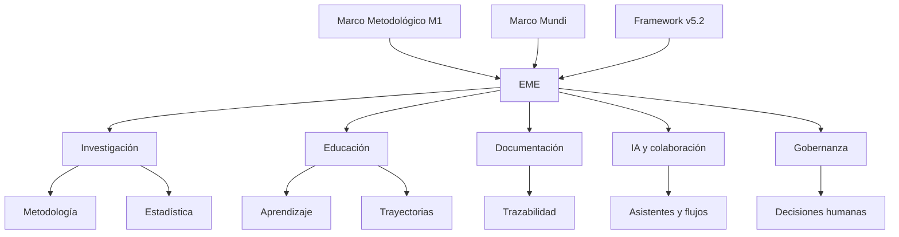

# EME · Estudio Metodológico-Estadístico

> **Ecosistema educativo evolutivo** para investigación, aprendizaje, documentación activa y colaboración responsable entre personas e inteligencia artificial.


---

## ✨ Qué es EME

**EME** significa **Estudio Metodológico-Estadístico**.

Es un proyecto en construcción orientado a convertirse en un **ecosistema educativo evolutivo**, diseñado para articular:

- **investigación metodológica y estadística**;
- **educación y formación**;
- **documentación activa y trazabilidad**;
- **colaboración humano·máquina·IA**;
- **gobernanza responsable**;
- y **desarrollo progresivo de recursos, estructuras y aplicaciones**.

Su propósito es servir a públicos escolares, universitarios, docentes, investigadores, expertos disciplinares y público general, manteniendo siempre **gobernanza humana**, **veracidad** y **sostenibilidad documental**.

---

## 📌 Estado actual del proyecto

| Componente | Estado |
|---|---|
| Estructura base del proyecto | ✅ Instalada |
| Modalidad START del Framework v5.2 | ✅ Completada |
| Línea base Git inicial | ✅ Publicada |
| Marco metodológico M1 v1.0.0 | ✅ Aprobado e incorporado |
| Marco Mundi v1.0.0 | ✅ Incorporado |
| Gobernanza inicial y trazabilidad | ✅ Iniciadas |
| Productos educativos/aplicaciones específicas | ⏳ En desarrollo |
| Evaluación de madurez N1–N4 | ⏳ Pendiente |

> **Estado público actual:** este repositorio ya tiene una base real de trabajo, pero todavía se encuentra en **fase inicial activa**.

---

## 🎯 Propósito

EME busca **desarrollar, organizar y transferir capacidades metodológicas y estadísticas** dentro de un marco educativo responsable, con apoyo de inteligencia artificial y bajo **decisión humana**.

### Objetivos iniciales

- fortalecer el razonamiento metodológico y estadístico;
- construir una arquitectura documental clara y mantenible;
- facilitar la colaboración entre personas e IA;
- crear un entorno reproducible y auditable;
- producir materiales, guías, estructuras y artefactos educativos;
- evolucionar hacia un ecosistema transdisciplinario útil y sostenible.

---

## 🧭 Fundamentos del proyecto

EME se apoya actualmente en **tres pilares principales**:

### 1) Marco metodológico
**M1 v1.0.0**  
Marco metodológico canónico aprobado del proyecto EME.

### 2) Fundamento pedagógico longitudinal
**Marco Mundi v1.0.0**  
Aporta una base transdisciplinaria y una lógica de **transferencia simétrica reversible (TSR)**.

### 3) Arquitectura operativa
**Framework Genérico v5.2**  
Proporciona la estructura de cartapacios, la activación START y el marco de trazabilidad y organización general.

---

## 🧠 Perfiles activos

EME inicia con una activación triádica, proporcional y gobernada humanamente:

| Perfil | Rol general |
|---|---|
| **PH** | Programador Humanista |
| **IT** | Investigador Transdisciplinario |
| **AT** | Artista Transdisciplinario |

> La activación de estos perfiles **no significa despliegue automático de agentes**. Representa una estructura de trabajo autorizada para orientar el desarrollo del proyecto.

---

## 🗂️ Estructura general del repositorio

El proyecto utiliza la macroestructura del **Framework v5.2**, organizada en **23 cartapacios principales**.

<details>
<summary><strong>Ver estructura principal</strong></summary>

```text
00_CONTROL_MAESTRO
01_FUNDAMENTO_FILOSOFICO
02_ARQUITECTURA_CONCEPTUAL
03_METODOLOGIA_Y_FLUJO_DE_TRABAJO
04_GOBERNANZA_ETICA_Y_RIESGOS
05_COMPETENCIAS_Y_PERFILES
06_PASTILLAS_MODULARES
07_PLANTILLAS_Y_MODELOS
08_CURSOS_PROGRAMAS_Y_TRAYECTORIAS
09_IA_AGENTES_Y_COPILOTOS
10_REPOSITORIOS_Y_FLUJO_TECNICO
11_MULTIMODALIDAD_Y_PUBLICACION
12_DISENO_INSTRUCCIONAL_UNIVERSAL
13_INVESTIGACION_Y_EVIDENCIA
14_COMUNIDAD_TRANSFERENCIA_Y_ESCALAMIENTO
15_EVALUACION_CALIDAD_Y_AUDITORIA
16_SEGURIDAD_PRIVACIDAD_Y_DATOS
17_INTERNACIONALIZACION_LOCALIZACION
18_DOCUMENTACION_ACTIVA
19_IMPLEMENTACION_Y_DESPLIEGUE
20_MANTENIMIENTO_Y_EVOLUCION
21_WIKI_DOCUMENTACION_HUMANA
99_ARCHIVO_HISTORICO
```

</details>

---

## 🔄 Vista general del ecosistema



---

## 📚 Documentos fundacionales visibles

En esta etapa, la base pública del proyecto incluye:

- **Marco Metodológico M1 v1.0.0**
- **Marco Mundi v1.0.0**
- **Ficha de Activación START**
- **Acta de Aprobación y Trazabilidad de M1**
- **Bitácora de sesión inicial**

> Los documentos fuente originales en Word y PDF **se mantienen fuera de esta primera línea base pública**.

---

## 🛡️ Principios de trabajo

Este proyecto se guía por los siguientes principios:

1. **Veracidad**  
   No inventar; distinguir evidencia, inferencia y propuesta.

2. **Gobernanza humana**  
   Las decisiones estratégicas y sensibles corresponden a la autoridad humana.

3. **Trazabilidad**  
   Toda decisión importante debe quedar documentada.

4. **Baja carga cognitiva**  
   El trabajo se organiza en pasos claros, breves y manejables.

5. **Sostenibilidad**  
   Se priorizan estructuras mantenibles y se evita la sobreingeniería.

6. **Transdisciplinariedad**  
   Se integran dimensiones pedagógicas, metodológicas, técnicas, éticas e investigativas.

---

## 🚀 Qué sigue

La siguiente etapa del proyecto se enfocará en:

- consolidar la documentación pública básica;
- definir la gobernanza operativa mínima;
- estructurar el plan de sesiones de trabajo;
- preparar criterios de calidad y contribución;
- y comenzar el desarrollo progresivo del ecosistema EME.

---

## 🤝 Forma de trabajo

EME se desarrolla mediante una combinación de:

- dirección humana;
- organización documental;
- trabajo técnico progresivo;
- y asistencia de inteligencia artificial bajo control y revisión humana.

---

## 📍 Qué encontrará el público en este repositorio

En esta etapa inicial, este repositorio ofrece principalmente:

- la **estructura base del proyecto**;
- sus **fundamentos documentales**;
- la **línea base de activación START**;
- y el **punto de partida formal del desarrollo**.

No representa todavía una implementación final ni una colección completa de productos terminados.

---

## 📄 Licencia

Este repositorio incluye licencia **MIT**.  
Consulta el archivo [`LICENSE`](./LICENSE).

---

## ✨ Nota final

EME no busca ser solo un repositorio técnico.

Busca convertirse en un **ecosistema educativo vivo, documentado, responsable y evolutivo**, capaz de articular investigación, pedagogía, metodología, tecnología e inteligencia artificial con sentido humano.
